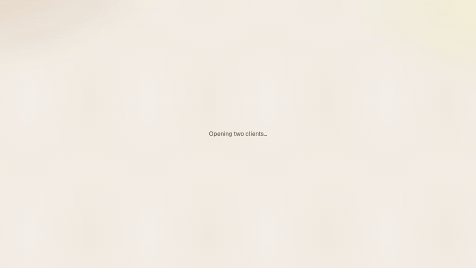
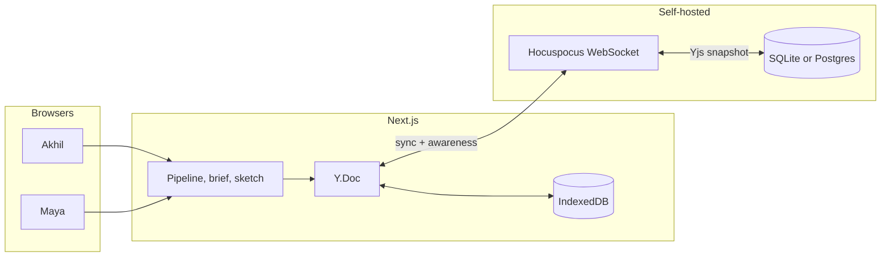

# Tandem

Two people. One pipeline. Live.

Tandem is a real-time job-hunt studio built by [Akhilendra Singh](https://github.com/AkhilSingh2). Open a room and share the link. The other person gets a cursor, a name, and the same board. Drag a role, write the brief, sketch the system. If the socket drops, keep typing. The edits merge when it comes back.

No accounts. No paid APIs. SQLite on your machine.

**Live demo:** [akhilsingh2.github.io/tandem](https://akhilsingh2.github.io/tandem/) (try [the two-person demo](https://akhilsingh2.github.io/tandem/demo/)). The hosted copy runs in demo mode with sample data: there is no websocket server on GitHub Pages, so clients in the same browser sync the Yjs document and presence over a BroadcastChannel instead. Build it with `STATIC_DEMO=true` (see `src/lib/demo`).



## Features

- **Pipeline.** Five columns — Wishlist, Applied, Screen, Interview, and Offer — with drag and drop, priorities, and a detail drawer.
- **Shared brief.** A collaborative document. Two people can type in the same paragraph and both sentences stay.
- **Sketch.** A whiteboard whose strokes are stored as normalized points, so different window sizes still draw the same picture.
- **Presence.** Avatars, names, and live cursors on every surface.
- **Comments.** On a role, and on the brief. Append-only, so neither person overwrites the other.
- **Undo and redo.** Local edits only. Someone else's typing is not yours to undo. `⌘Z` / `Ctrl+Z`.
- **Offline.** The document lives in IndexedDB. Reconnect and Yjs merges it with the server copy.
- **Shareable rooms.** The link is the permission. Copy it from the header.
- **Two-person demo.** `/demo` opens two real clients side by side. Nothing is replayed.
- **Light and dark.** A paper-and-ink theme, with a toggle that sticks.

## Architecture



A keystroke never waits on the server. It lands in the local Y.Doc, the screen updates, and the update is streamed out. The other browser applies that update and paints. Awareness (cursors, names, in-progress strokes) travels on the same socket and is not saved. The document is.

## Stack

| Piece | Choice |
| --- | --- |
| App | Next.js 16, React 19, TypeScript |
| UI | Tailwind CSS 4, dnd-kit, Framer Motion |
| CRDT | Yjs |
| Sync | Hocuspocus (`@hocuspocus/server` + provider) |
| Offline | y-indexeddb |
| Persistence | SQLite via `node:sqlite`, or Postgres when `DATABASE_URL` is set |
| Tests | Vitest, Playwright |

## Run

Node 22 or newer.

```bash
npm install
cp .env.example .env.local
npm run dev
```

- App: http://127.0.0.1:3000
- WebSocket: ws://127.0.0.1:1234
- Health: http://127.0.0.1:1234/health

`npm run dev` starts Next.js and the websocket server together. Open **Two-person demo** on the landing page if you want both clients immediately.

```bash
npm run lint
npm run typecheck
npm test
npm run build
npm run test:e2e
```

The end-to-end suite includes a two-browser test: one client types in the brief, the other sees it, then a card and a comment cross the socket the other way.

## Deploy later

The web app and the websocket server are separate processes. Vercel can host the Next.js app. Fly.io or Render can host the websocket server. Nothing here calls a paid API.

1. **WebSocket on Fly.** From the repo root, after `fly launch` against the included `fly.toml`:

   ```bash
   fly volumes create tandem_data --size 1
   fly deploy
   ```

   `deploy/Dockerfile` runs `server/index.ts` on Node 22. The volume keeps the SQLite file at `/data/tandem.sqlite`. `GET /health` is the check. To use Postgres instead, set `DATABASE_URL` and skip the volume. The connection string is not printed in logs.

2. **Next.js on Vercel.** Import the repo. Set `NEXT_PUBLIC_WS_URL` to the Fly websocket URL, including `wss://`, at build time. That value is compiled into the client.

3. **Render.** Same Docker image, a persistent disk mounted at `/data`, health check path `/health`, and the same env vars as `.env.example`.

Rooms are unguessable ids. There is no login, so the link is the secret. Don't post a private search board in public.

## What this demonstrates

- A CRDT instead of last-write-wins for the brief, card notes, the pipeline, comments, and strokes.
- Awareness as a separate channel from the document, so cursors don't bloat the saved state.
- Optimistic UI: the local document updates before the server acknowledges.
- Offline-first editing with a real merge on reconnect, covered by a unit test and by the socket server test.
- A self-hosted sync server with a swappable store. SQLite by default, Postgres when you point it there.
- Accessible drag and drop, keyboard undo, labeled controls, and a theme that respects contrast.

The study notes are in [docs/LEARNING.md](docs/LEARNING.md): websockets, CRDTs, presence, conflict cases, offline sync, and how this shape scales.

## Layout

```
src/app            landing, room, demo
src/components     pipeline, brief, sketch, presence
src/lib/board.ts   Y.Doc operations, tested without a browser
server/            Hocuspocus process and SQLite/Postgres store
e2e/               Playwright, including the two-client sync test
deploy/            Dockerfile for the websocket server
```
