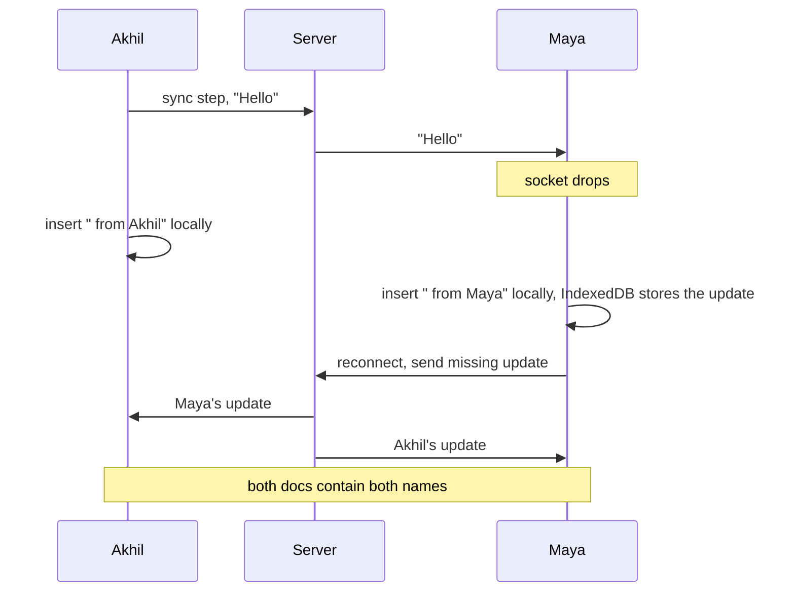

# Learning Tandem

A study guide for the ideas in this repo. Read it next to the code, then do the exercises at the bottom. Solutions are at the end so you can try first.

## 1. Why a socket, not another request

HTTP is a question and an answer. That fits "load my board." It does not fit "Maya moved a card while I was looking at it."

A WebSocket is one connection that stays open. Either side can send a frame at any time. Tandem uses it for two kinds of frames:

- **Document updates.** Binary Yjs payloads. These are the source of truth and they get saved.
- **Awareness.** Ephemeral JSON: name, color, cursor, the stroke still being drawn. These are not saved. When you disconnect, your cursor disappears. That is the point.

The server is `server/index.ts`. It is a [Hocuspocus](https://tiptap.dev/docs/hocuspocus/introduction) process. Hocuspocus speaks the Yjs sync protocol, so the client does not invent a message format. `GET /health` is a normal HTTP response on the same port, which is what Fly and Render poke.

Try this: open `/demo`, then stop the websocket process. Both panes flip to Offline. Type in the brief anyway. Start the server again. The other pane catches up without a refresh.

## 2. What a CRDT is doing here

If two people edit the same text and we only keep the last save, one of them loses a sentence. A conflict-free replicated data type (CRDT) is a data structure whose merge is a pure function of the updates, not of who arrived last.

[Yjs](https://docs.yjs.dev/) gives Tandem a few of those structures inside one `Y.Doc`:

| Shared type | Used for | Why this type |
| --- | --- | --- |
| `Y.Text` `brief` | The shared brief | Inserts and deletes address characters, not the whole string |
| `Y.Text` inside `notes` | Notes on a role | Same merge, scoped to one card |
| `Y.Map` `cards` | Roles, keyed by id | Two new cards are two keys, so both survive |
| `Y.Map` `comments` | Comments, keyed by `thread::id` | Same reason. A nested array would lose a concurrent first comment |
| `Y.Array` `strokes` | Finished pen strokes | Concurrent pushes both stay |

`src/lib/board.ts` is the only place that writes these types. The React components read them. That split is why the merge tests do not need a browser.

Last-write-wins still exists, on purpose, for short fields like company and role. Each keystroke replaces the whole string. If you and someone else type in **Company** at the same time, one of you wins that field. The brief does not work that way. The drawer says so, and the difference is the lesson.

## 3. A character, from key to the other screen

Follow one letter in the brief.

1. `beforeinput` fires in `src/components/editor.tsx`. The handler calls `preventDefault`, so the browser does not also insert the character into the DOM.
2. `planTextInput` in `src/lib/text.ts` decides the index, what to delete (the selection), and where the caret should land.
3. `ytext.insert(index, "a")` runs inside `doc.transact`. Yjs records an insert item tagged with this client's id and a clock.
4. The local observer paints `textContent` and puts the caret back. The screen has already changed. The server has not.
5. The Hocuspocus provider listens to `doc.on("update")` and sends the binary update on the socket.
6. The server applies it to the in-memory document and relays it to every other connection in that room.
7. Maya's `Y.Text` observer runs. Her caret is adjusted with `adjustCaret` so a remote insert before her cursor does not leave her in the wrong place.
8. A few hundred milliseconds later the server writes `Y.encodeStateAsUpdate` into SQLite (`server/persistence.ts`). Crash the process after that and the letter is still there.

That local-first step is the optimistic UI. There is no spinner between the key and the glyph.

## 4. Presence is not the document

Cursors move dozens of times a second. If they were `Y.Map` keys they would be stored forever and replayed to the next person who joins. They are not history. They are "who is here right now."

Yjs calls that channel **awareness**. `room-provider.tsx` sets `user`, `cursor`, and `draft` on the provider. `presence.tsx` subscribes and draws avatars and name tags. The in-progress pen stroke is a `draft` so the other person sees the line before the pen lifts. On pointer-up it becomes one `Y.Array` item, and the draft is cleared.

Awareness state dies with the connection. That is why a refresh gives you a new cursor id even though your name came back from `localStorage`.

## 5. Conflicts, with the actual cases

**Two people insert in the brief while offline.** Both call `insert` at index 5 of `"Hello"`. After the merge both strings are equal, both contain both inserts, and the order is deterministic (client ids), not "whoever saved last." `src/lib/board.test.ts` asserts this. You cannot predict whether Ava's word sits left of Maya's, but you can predict that neither word disappears, and that both replicas agree.

**Two people add different roles.** Cards are map keys. Different ids, both kept. Order inside a column is a `rank` number. `rankBetween` picks a value between the neighbors so a move is one number write, not a rewrite of the whole column.

**Two people comment at the same moment, before any comment exists.** The first version of this stored comments in a `Y.Array` created on demand. Both clients created an array and wrote it to the same map key. Yjs keeps one of those arrays. One comment vanished. The fix is a flat map: `threadId::commentId` as the key. Concurrent creates of different keys both survive. The test `appends comments without dropping either side` locks that in.

**Two people edit Company.** Last write wins. Say that out loud in an interview. Knowing where you did *not* use a CRDT is part of using one.

**Undo.** `Y.UndoManager` tracks transactions whose origin is local. Remote updates and the seeded room (`SEED_ORIGIN`) are not on your undo stack. Undo does not reach across the table and delete Maya's sentence.

## 6. Offline, then reconnect

IndexedDB (`y-indexeddb`) is the safety net for a refresh while you are offline. The server snapshot is the safety net for a new browser. Yjs merges them because every update is addressed, not because either copy is declared the winner.

`server/sync.test.ts` does this without a browser: connect two providers, disconnect one, edit both, reconnect, assert one string.

## 7. How this scales, and where it stops

This server keeps each open room in memory and writes a snapshot to one database. That is the right shape for a portfolio and for a small team.

The walls, in order:

1. **One process.** Every connection for a room must see the same in-memory `Y.Doc`. Two Fly machines without a shared relay will silently fork a room. The usual fix is a pub/sub extension (Hocuspocus has a Redis one) so every machine applies the same updates, plus sticky sessions so awareness fan-out stays cheap.
2. **Snapshot size.** `encodeStateAsUpdate` stores the whole document. Fine for a job hunt. A whiteboard with tens of thousands of strokes wants compaction, or a separate store for strokes.
3. **Awareness fan-out.** Cursors are O(people in the room) per move, and we already throttle them to one frame. A room of hundreds needs coarser presence (viewport, not pixels).
4. **Auth.** The room id is the capability. At a company you would check it in `onLoadDocument` and reject the socket. The hook is already there. It only checks the id shape today.
5. **History.** Undo is per tab. A real audit log is a separate append-only table of updates, not the undo stack.

You do not need any of that to understand the system. You need it the moment two servers both think they own the room.

## Exercises

1. Trace `adjustCaret`. In a doc containing `"Hello"` with the caret at 5, what should the caret be after a remote insert of `"X"` at index 0? After a remote delete of the `"e"`? Check yourself against `src/lib/text.test.ts`, then change the test's expected value and watch it fail for the right reason.
2. Open two browsers on one room. Turn off Wi-Fi on one of them (or stop `server/index.ts`). Add a different card on each side. Turn the network back on. Which cards exist, and which code path merged them?
3. In `addComment`, put the comments back in a `Y.Array` stored on a single map key. Run `npm test`. Which test fails, and what does the failure teach you that a blog post would have skipped?
4. Cursors are percentages of the surface, not document positions. Resize one demo pane while the other stays wide. Why does a cursor sitting on a card not stay glued to that card? What would you store instead if it had to?
5. `planMove` inserts a card *before* the card you drop on. Write the ranks for a column `[10, 20, 30]` when you drop the card from another column onto `20`. What rank do you get, and what happens when the gap shrinks under `1e-6`?
6. Sketch a third shared type: a checklist on the brief, items `{ id, text, done }`. Which Yjs type would you pick so two people can check different boxes offline and both checks survive? Write the merge on paper before you write the code.
7. The websocket server is one Node process. Draw what breaks if you `fly scale count 2` with no Redis and no sticky sessions. Which user-visible bug shows up first, a forked document or a cursor that only one machine can see?

## Solutions

1. Insert of `"X"` at 0 moves the caret from 5 to 6. Deleting `"e"` (one character before the caret, at index 1) moves it from 5 to 4. `adjustCaret` walks the Yjs delta: inserts at or before the caret shift it right, deletes strictly before the caret pull it left.
2. Both cards exist on both browsers. `addCard` writes a new key on the `cards` map. The sync test's offline section is the same shape for text. The card path is covered by `merges cards added offline on two replicas`.
3. `appends comments without dropping either side` fails. Both clients create a fresh array and assign it to the same key. The map keeps one array. Flat keys do not collide.
4. Percentages describe the panel, not the card. After a resize the panel's geometry changes and the card is no longer at that percentage. To glue a cursor to a card you would store a card id plus an offset inside it, and render from layout. Tandem deliberately does not, because cursors are awareness and the board scrolls.
5. Dropping onto the card ranked 20 places you between 10 and 20, so the rank is 15. `moveCard` calls `rebalanceColumn` when two neighbors get within `1e-6`, rewriting the column to `1024, 2048, 3072, ...`.
6. A `Y.Map` keyed by item id. `text` can be a nested `Y.Text` if you want character-level merge, or a string if last-write-wins is acceptable for a short line. `done` is a boolean on the map. Two clients setting `done` on different ids both stick. Two clients toggling the same boolean are last-write-wins, which is usually what a checkbox wants. Do not use one `Y.Array` of objects created independently on each side unless the array already exists on both before they diverge.
7. Each machine has its own in-memory document. A client routed to machine A will not see an update that landed on machine B, so the board forks until something external merges them, which nothing does. Cursors break the same way, and you notice that first because they move constantly. The document fork is the serious one. A Redis (or NATS) relay, or a single machine, is the fix. Sticky sessions alone are not, because a reconnect can land on the other machine and load a stale snapshot over the live one.
